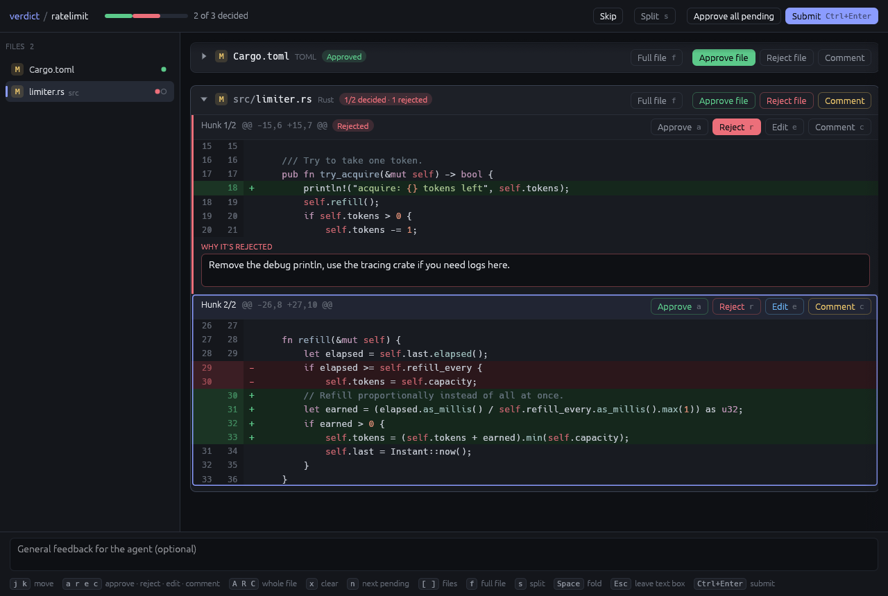
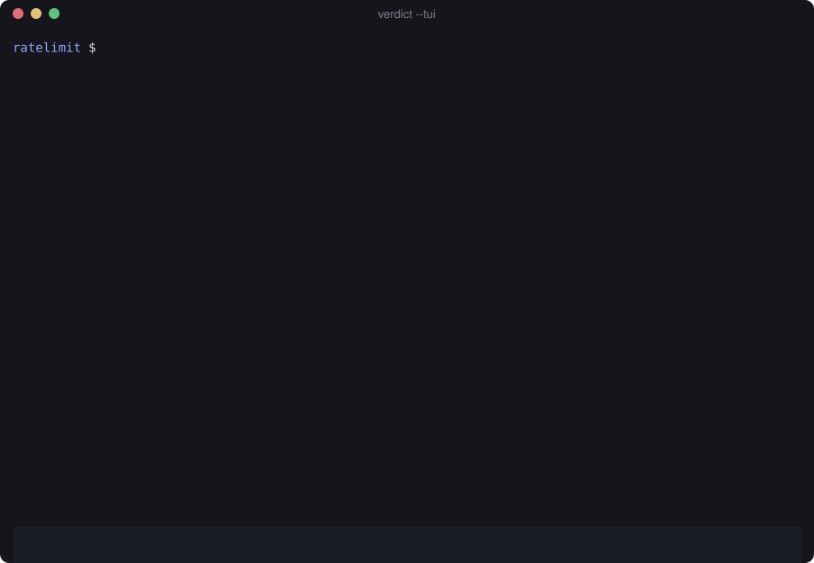

# verdict

**Code review for AI-written changes, hunk by hunk, fed straight back to the agent.**

verdict is a small native app, written in Rust, that opens when your coding agent
finishes a turn. It runs as a native window (egui) or right in your terminal
(ratatui). It shows exactly what changed. You approve, reject, edit or
comment on each hunk or each whole file. Your verdict goes back to the agent as its
next instruction.



## Why

With an AI agent writing the code, most of the work is reading and judging its
diffs. General-purpose editors aren't built for that loop. They're heavy, they're
slow to start, and they leave you to type the feedback out yourself.

verdict does one job:

- **It starts fast.** It's a native binary with no runtime, and the window opens
  in a fraction of a second.
- **Decisions are real git operations.** Approving stages the hunk. Rejecting
  reverts it in your working tree. Nothing changes on disk until you submit.
- **Feedback is structured.** Each rejected hunk carries your reason, and each
  edit is shown to the agent as its version next to yours. The agent gets one
  clear message instead of a vague "that's wrong".
- **It stays out of the way.** It only opens when the session that just stopped
  changed something, and it only shows the files that session changed.

## Features

- Approve, reject, edit or comment on each **hunk**.
- Approve, reject or comment on a **whole file**. A whole-file rejection carries
  one reason for all its hunks.
- Edit hunks inline. The agent sees exactly what you changed.
- **Full file** view: show the whole file, with unchanged code between the hunk
  cards, when 3 lines of context aren't enough.
- **Split view**: old and new side by side, in the window and in the terminal.
- Each file is a card with its hunks numbered (1/3, 2/3, ...) and joined in the
  gutter. Cards fold away when you're done with them.
- Syntax highlighting for about 200 languages out of the box. You can add more
  with **VS Code extensions**, TextMate grammars, Sublime syntaxes and VS Code
  themes.
- Files are highlighted from their first line, so a hunk that starts inside a
  multi-line comment or string still renders correctly.
- Keyboard-driven, but every action is also a button.
- **Window or terminal**: the same review as a native window or a terminal UI.
  It works over SSH and in tmux.
- **Claude Code** integration through hooks. It works standalone with any agent.

## Install

verdict needs `git`, a Rust toolchain (1.85+, edition 2024) and a C compiler. The
C compiler builds Oniguruma, the regex engine VS Code grammars are written for.

```sh
git clone https://github.com/ZamboniL/verdict
cd verdict
cargo install --path .
```

This installs the `verdict` binary into `~/.cargo/bin`.

**Platforms**

- **Linux:** tested, including **WSL2**. On WSL2 it runs as a Linux GUI app
  through WSLg, so it reads your repo at native speed without going through the
  slow Windows-to-WSL file bridge.
  The window uses whichever of X11 and Wayland is available. When both are, it
  uses Wayland only if `XDG_SESSION_TYPE=wayland`. WSLg offers both and sets no
  session type, so verdict uses X11 there, which also avoids a WSLg compositor
  crash when a Wayland window is resized. X11 needs
  `libxkbcommon-x11-0` (`sudo apt install libxkbcommon-x11-0`); without it,
  verdict warns and uses Wayland. `VERDICT_GUI_BACKEND=wayland` or `x11`
  overrides the choice.
- **macOS:** expected to work, but not tested yet.
- **Native Windows:** not supported yet. Use WSL2.

## Quick start

Run it inside any git repository that has uncommitted changes:

```sh
verdict
```

Review, then press **Ctrl+Enter** to submit (**S** or **Ctrl+S** in the terminal). The feedback message prints to stdout
and is also saved to `.git/verdict-feedback.md`, so you can paste it into any
agent: Claude Code, Codex, Aider, Cursor, or anything else.

### Staged changes and commits

verdict also reviews changes that are already staged or committed:

```sh
verdict --staged          # what's staged (HEAD -> index)
verdict HEAD~3..          # the last three commits
verdict main...feature    # a branch, from where it left main
```

These reviews are **feedback only**: approving, rejecting and commenting build
the feedback message, but nothing in git changes and hunks can't be edited.
Ranges work like `git diff`: `A..B`, `A..` (up to `HEAD`) and `A...B` (from the
point where `B` branched off `A`).

## Window or terminal



```sh
verdict --gui     # native window
verdict --tui     # terminal interface
```

Without a flag, verdict uses `$VERDICT_UI` (`gui`, `tui` or `auto`), then `mode` in
the `[ui]` section of `config.toml`, then **auto**: the window when a display is
available, otherwise the terminal.

The terminal interface draws on `/dev/tty`, so `verdict --tui > review.md` still
works. Notes are typed in the bottom bar. **Ctrl+O** opens a note in `$EDITOR`
instead, and **e** edits a hunk in `$EDITOR`. Press **?** for every key.

**From the hook**, Claude Code owns the terminal, so the terminal interface opens
somewhere else:

- **Inside tmux**, it opens in a popup over the agent (tmux 3.2+). To keep the
  agent's pane visible while you review, open it next to the agent instead:

  ```toml
  [ui]
  tmux = "split"    # or "window" for a new tmux window; default "popup"
  ```
- **Otherwise**, set a command that opens a terminal emulator. verdict appends its
  own command to it:

  ```toml
  [ui]
  mode = "tui"
  terminal = ["wezterm", "start", "--"]   # or ["kitty"], ["gnome-terminal", "--wait", "--"]
  ```

  If there's neither, verdict falls back to the window when it can open one.

To leave the window out of the build, for example on a server:
`cargo install --path . --no-default-features --features tui`.

## Claude Code integration

Add both hooks to `~/.claude/settings.json`, or to a project's
`.claude/settings.json`:

```json
{
  "hooks": {
    "UserPromptSubmit": [
      { "hooks": [{ "type": "command", "command": "verdict hook", "timeout": 30 }] }
    ],
    "Stop": [
      { "hooks": [{ "type": "command", "command": "verdict hook", "timeout": 86400 }] }
    ]
  }
}
```

1. **When you send a prompt**, verdict records a snapshot of the working tree for
   that session. This takes a few milliseconds and prints nothing.
2. **When the agent finishes its turn**, verdict works out which files that
   session changed during the turn. It compares against the snapshot and checks
   the session's transcript for the tools it used.
   - If nothing changed, for example because the session was only answering a
     question, verdict stays closed.
   - Otherwise the review window opens, showing only those files.
   - Press **t** to read what the agent said at the end of its turn (the
     **Agent's message** button in the window).
3. **When you submit:**
   - If you approved everything, the agent finishes normally.
   - Otherwise your review becomes the agent's next instruction, and it keeps
     working on your feedback. The next review shows only what it changed in
     response.

The long `Stop` timeout lets you take your time reviewing. Set `VERDICT_DISABLE=1`
in the environment to turn verdict off for a session.

## Reviewing

| Action | Hunk | Whole file |
|---|---|---|
| Approve (stage it) | `a` | `Shift+A` |
| Reject (revert it, with a reason) | `r` | `Shift+R` |
| Edit inline | `e` | — |
| Comment (keep it, send a note) | `c` | `Shift+C` |

| Key | Does |
|---|---|
| `j` / `k` | next / previous hunk |
| `]` / `[` | next / previous file |
| `g` / `G` | first / last hunk |
| `n` | jump to the next undecided hunk |
| `x` | clear the hunk's decision |
| `f` | show the whole file around its hunks |
| `s` | split view: old and new side by side |
| `t` | what the agent said (reviews opened by the hook) |
| `Space` | fold / unfold the current file |
| `Esc` | leave a text box |
| `Ctrl+Enter` | submit (in the terminal: `S`, which asks first, or `Ctrl+S`) |

The terminal interface adds `Enter` (write the note), `m` (general message) and
`q` (quit). `?` lists them all. To start in the split view, set `layout = "split"`
in the `[ui]` section of `config.toml`.

Pressing an active decision again clears it. **Approve file** folds the card and
moves on to the next undecided file. Hunks you leave undecided stay as they are,
unstaged, and show up again in the next review.

### What the agent receives

````markdown
# Code review of your changes
Summary: 2 approved, 1 rejected, 0 edited by reviewer, 0 commented, 0 not reviewed yet.

## Rejected (reverted in the working tree)

### `src/limiter.rs` (1 of 2 hunks)

Hunk 1/2 @@ -15,6 +15,7 @@
```diff
     pub fn try_acquire(&mut self) -> bool {
+        println!("acquire: {} tokens left", self.tokens);
         self.refill();
```

**Why it was rejected:** Remove the debug println, use the tracing crate if you need logs here.
````

## How it works

**The git index is the "approved" state.** verdict compares the index with your
working tree. On submit:

- **Approved hunks** are written into the index.
- **Rejected hunks** are reverted in the working tree.
- **Edited hunks** get your version in both places.

Hunks you didn't decide on are left alone. There's no extra database: plain git
shows the outcome, and `git diff --cached` shows everything you've approved.

**Which session changed what.** Several agent sessions can work in the same repo,
or just chat, so verdict tracks changes per session. A snapshot of content hashes
taken at the start of each turn tells it what changed during that turn. The
session's transcript tells it whether that session could have made the change:

- **The session only chatted:** no review.
- **It only used file-editing tools:** only the files it edited are shown.
- **It ran shell commands:** every file changed during the turn is shown.

## Syntax highlighting

bat's collection of syntaxes and themes is built in. Run `verdict langs` and
`verdict themes` to see what's available.

### Extending it

Run `verdict init` to create `~/.config/verdict` (or `$XDG_CONFIG_HOME/verdict`):

| Path | Accepts |
|---|---|
| `config.toml` | interface choice, theme and file associations |
| `grammars/` | `.sublime-syntax`, `.tmLanguage`, `.tmLanguage.json` |
| `themes/` | `.tmTheme`, VS Code color themes (`.json`) |
| `extensions/` | unpacked VS Code extensions |

**VS Code extensions.** A `.vsix` file is a zip archive. Unzip it into
`extensions/`:

```sh
unzip svelte-vscode.vsix -d ~/.config/verdict/extensions/svelte
verdict langs | grep user
```

verdict reads the `contributes` section of each extension's `package.json`:

- `grammars`: the TextMate grammars
- `languages`: the extensions, filenames and first-line patterns that decide
  which files a grammar applies to
- `themes`: color themes

**config.toml**

```toml
[highlight]
theme = "OneHalfDark"

[languages]                                # like VS Code's files.associations
"*.mdx" = "Markdown"                       # no "/": matches the file name
"Justfile" = "Makefile"
"docker/**/*.env" = "source.shell.bash"    # with "/": repo-relative path
```

Association values can be a language name, a scope (`source.ts`) or an
extension (`ts`).

**How a language is chosen:**

1. Your associations.
2. File names declared by extensions.
3. The file extension. The longest match wins, so `d.ts` beats `ts`.
4. The first line, for shebangs and similar.

Languages you add take priority over builtin ones.

`verdict lang path/to/file` shows which language a file gets.

**How TextMate grammars load.** The highlighting engine,
[syntect](https://github.com/trishume/syntect), reads Sublime's format, so
verdict converts TextMate grammars when it loads them:

- `begin`/`end` rules become push/pop contexts.
- The repository becomes named contexts.
- Cross-grammar `include`s resolve against every grammar verdict knows about.

Rules that can't be converted are skipped and listed by `verdict langs`. Known
limits:

- `while` rules are approximated.
- Injection grammars are skipped.
- `$1`-style scope names are dropped.

Compiled user grammars are cached in `~/.cache/verdict` and rebuild automatically
when a file changes.

## Command reference

```
verdict [PATH]     review uncommitted changes in the repo containing PATH
verdict --staged   review staged changes (feedback only)
verdict RANGE      review a commit range such as HEAD~3.. (feedback only)
verdict hook       Claude Code hook entry point (UserPromptSubmit and Stop)
verdict langs      list languages and grammar warnings
verdict themes     list syntax themes (* = active)
verdict lang FILE  show which language FILE is highlighted as
verdict init       create the config directory with an example config.toml
```

## Limitations

- **Two sessions running shell commands in the same repo at the same time** can
  still see each other's edits. A shell command could have touched any file, so
  verdict can't attribute those edits to one session.
- **Symlinks and submodules** are skipped. **Binary files** can be approved or
  rejected as a whole, but not edited.
- **Rejecting part of a change can leave code that doesn't build.** For example,
  rejecting the hunk that removes a field while keeping the hunks that stop using
  it. The agent gets the rejection and usually fixes it, but verdict doesn't
  check.

## Roadmap

- Optional check command, such as `cargo check`, run after applying decisions,
  with failures added to the feedback.
- Commit approved changes from inside verdict.
- Word-level highlighting inside changed lines.
- Native macOS and Windows builds.
- Integrations for other agents beyond Claude Code's hooks.

## Contributing

Issues and pull requests are welcome. The code is small and split by concern,
and `cargo test` runs the tests against real git repos in a temp dir.
[CONTRIBUTING.md](CONTRIBUTING.md) explains how to report bugs, how the code is
laid out, what a pull request needs, and how to script the window to take
screenshots.

## License

Copyright (C) 2026 the verdict contributors.

verdict is free software: you can redistribute it and/or modify it under the terms
of the **GNU General Public License, version 3 or (at your option) any later
version**. See [LICENSE](LICENSE) for the full text.

In short:
- You may use, study, modify and sell verdict.
- If you **distribute** it, modified or not, you must make the complete source
  available under the same license.
